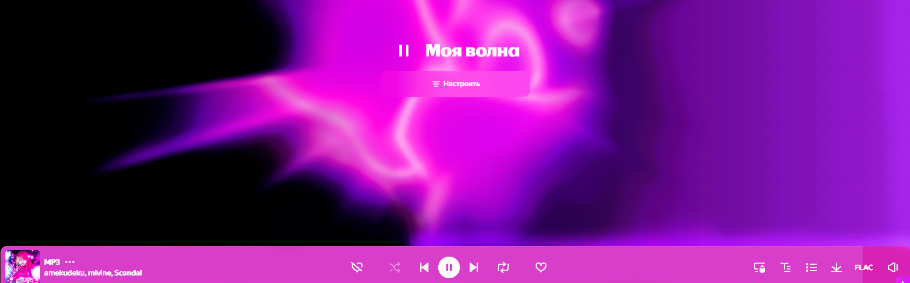

# Yandex Music Old Home UI

Аддон для PulseSync, который Реализует логику старого иинтерфейса Моей волны на главной странице Яндекс Музыки. ДЛЯ РАБОТЫ ВКЛЮЧИТЬ В ЭКСПЕРИМЕНТАХ `WebNextNewWaveTab` и `Настройки → Панель Плеера → Старая панель в новой Волне`



Поддерживает большинство тем, в том числе `ChromaSync`

При использовании с ChromaSync нужно либо сделать все фильтры в данном аддоне дефолтными, либо выключить кастомный цвет Волны в самом ChromaSync, так как они конфликтуют.

Сейчас аддон делает следующее:

- добавляет собственный блок управления
- возвращает кнопку `Моя волна`
- возвращает кнопку `Настроить`
- по нажатию на `Настроить` скрывает и возвращает `.swiper` с плавной анимацией
- скрывает всякий визуальный мусор

## Разработка и сборка

Проект переведён на [официальный шаблон PulseSync](https://github.com/PulseSync-LLC/PulseSync-ExampleAddon)
(основа: commit `98ea034a18e8e3a04b030c09cf9e0e41840c9d50`), Vite и `@pulsesync/addon-sdk` 0.16.0.
Нужны Node.js 20.19+ в ветке 20.x либо 22.12+ и Yarn 1.22.22, а для запуска аддона — актуальные PulseSync и мод с WebHost.

```bash
rtk proxy yarn install --frozen-lockfile
rtk proxy yarn run check
rtk proxy yarn test
rtk proxy yarn build
```

Готовый аддон: `dist/53a5ab330f89df3ced0497c8/`. Внутри находятся `metadata.json`, `script.js`, `script.css`, изображения и лицензия.
Для загрузки в магазин упаковывайте содержимое этого каталога; исходники, зависимости и локальные настройки в пакет не входят.

```bash
rtk proxy yarn dev
rtk proxy yarn sync
rtk proxy yarn build:sync
```

`dev` следит за изменениями, собирает и устанавливает аддон, `sync` устанавливает уже готовую сборку,
`build:sync` собирает и устанавливает. Клиент получает запрос на перезагрузку через локальный API PulseSync.
Каталог установки можно переопределить переменной окружения `PULSESYNC_ADDONS_DIR`.
Если репозиторий находится прямо в установленном аддоне, синхронизация обновляет только файлы сборки, сохраняя `.git`, исходники и `pulsesync.settings.json`.
После первого перехода со старого script-аддона перезапустите Яндекс Музыку: прежний скрипт не умел удалять свой интервал при отключении.

Исходники для редактирования:

- `src/runtime.js` — существующая логика интерфейса, подключённая к жизненному циклу SDK.
- `src/styles.css` — стили интерфейса; глобальная область явно включена через `cssScope: 'global'`.
- `src/main.tsx` — регистрация и запуск через `defineAddon`.
- `src/settings.ts` — настройки; SDK автоматически включает их схему в метаданные.
- `addon.config.mjs` — идентификатор, версия и метаданные.
- `addon/` — изображения и лицензия для готового пакета.
- `scripts/` — сборка для разработки и доставка из официального шаблона, адаптированные для установки поверх каталога проекта.

Корневые `script.js`, `script.css` и `metadata.json` — установленная сборка, они обновляются командой `sync`.
Отдельный `handleEvents.json` больше не нужен: схема настроек генерируется из `src/settings.ts` и включается в `metadata.json`.
Идентификатор аддона сохранён, старые числовые варианты колеса и настройка `customWaveWheel` продолжают поддерживаться в runtime.
